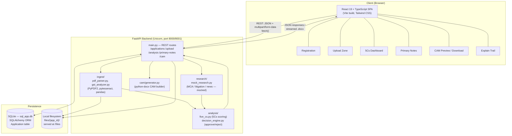
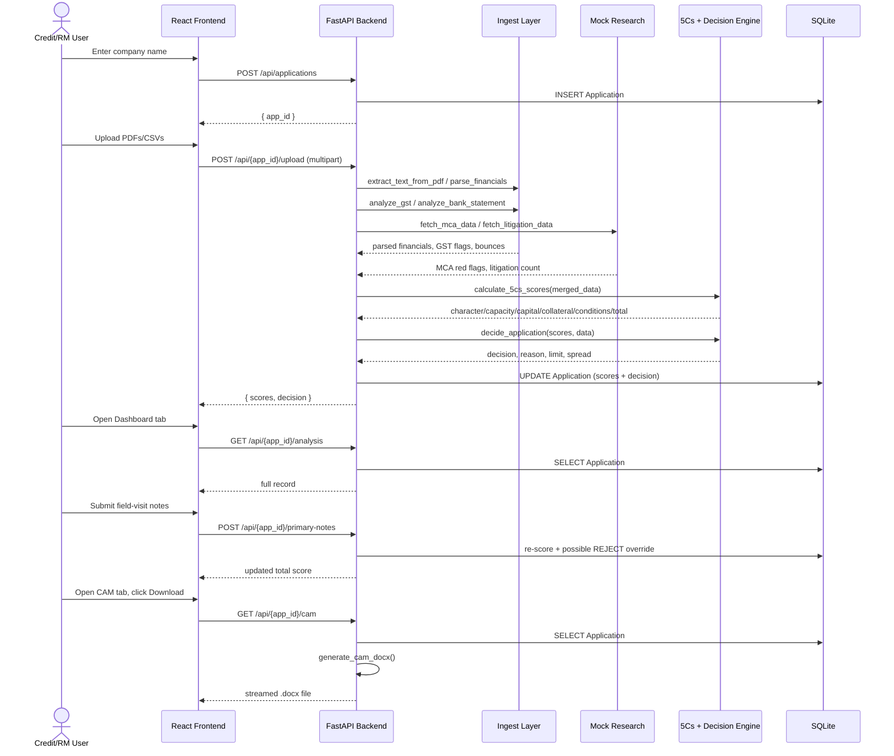
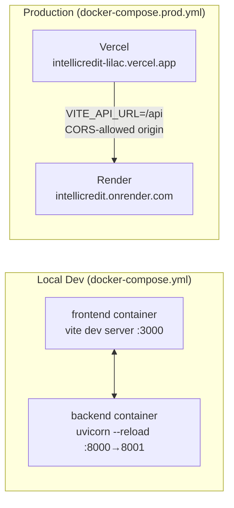

# Intelli-Credit

**Next-Gen Corporate Credit Appraisal Engine — built for the Indian banking context.**

Intelli-Credit automates the front-end of corporate credit underwriting: it ingests a borrower's financial documents (annual reports, GST returns, bank statements, legal notices, sanction letters), extracts and cross-verifies the numbers, scores the proposal against the classic **5 Cs of Credit**, applies a rules-based approve/reject decision engine, and generates a bank-ready **Credit Appraisal Memo (CAM)** as a downloadable Word document — all through a single-page web app.

---

## Table of Contents

- [What Problem It Solves](#what-problem-it-solves)
- [Core Features](#core-features)
- [How It's Useful](#how-its-useful)
- [Architecture](#architecture)
- [Tech Stack](#tech-stack)
- [Scoring & Decision Logic ("Models")](#scoring--decision-logic-models)
- [Project Structure](#project-structure)
- [API Reference](#api-reference)
- [Setup & Run](#setup--run)
- [Using the App](#using-the-app)
- [Known Limitations](#known-limitations--roadmap)

---

## What Problem It Solves

In Indian corporate banking, a credit officer preparing a CAM manually has to:

1. Read annual reports, GST filings, and bank statements to pull out financial ratios.
2. Cross-check GST sales/purchase data for fraud patterns like circular trading.
3. Scan bank statements for cheque bounces and legal notices for pending litigation (e.g. NI Act §138 cases).
4. Score the borrower across the 5 Cs of Credit (Character, Capacity, Capital, Collateral, Conditions).
5. Apply internal policy rules to arrive at an Approve/Reject decision, a recommended limit, and a pricing spread.
6. Write it all up in a formatted CAM document.

Intelli-Credit automates steps 1–6 into a single workflow, turning a multi-hour manual process into a few minutes of document upload + review.

## Core Features

1. **Data Ingestor** — Parses PDFs (with OCR fallback) and CSVs to extract revenue, EBITDA, DSCR, sanction limits, and litigation details; analyzes GST returns for **circular trading** and revenue-inflation red flags, and bank statements for **cheque bounces**.
2. **Research Agent** — Pulls (mocked) MCA filings, director DIN status, charge details, litigation records, and news sentiment to enrich the credit picture.
3. **5Cs Scoring Engine** — Weighted, rules-based scoring across Character (25%), Capacity (30%), Capital (20%), Collateral (15%), and Conditions (10%).
4. **Decision Engine** — Deterministic Approve/Reject logic with a recommended credit limit and interest-rate spread.
5. **Human-in-the-loop Primary Notes** — A relationship manager can add qualitative/on-site notes (e.g. factory capacity utilization, management quality) that dynamically re-score and can flip a decision.
6. **CAM Generator** — Produces a formatted `.docx` Credit Appraisal Memo, streamed directly for download.
7. **Explainability Trail** — A UI tab surfacing how each score and decision was derived, for audit and transparency.

## How It's Useful

- **For credit/relationship managers**: cuts down manual data entry and cross-referencing across financial documents, GST returns, and bank statements.
- **For risk teams**: standardizes the 5 Cs scoring methodology and applies it consistently across every application, reducing subjective variance.
- **For fraud/compliance checks**: automatically flags GST circular trading, revenue inflation, cheque bounces, and NI Act §138 litigation — patterns that are easy to miss during manual review.
- **For documentation/audit**: generates a consistent, ready-to-file CAM document and keeps an explainability trail of how the final decision was reached.
- **As a demo/hackathon proof-of-concept**: shows an end-to-end credit appraisal pipeline (ingestion → analysis → scoring → decisioning → reporting) that can be extended with real data sources (actual MCA/CIBIL APIs, real OCR, ML-based scoring) in a production setting.

---

## Architecture

Intelli-Credit is a classic **3-tier, containerized monolith**: a React SPA talking to a single FastAPI service over REST, backed by SQLite and a local document store. There is no message queue, no microservices, and no external AI/ML service — every "smart" step is deterministic Python running in-process inside the API layer.

### System Architecture (component view)



### Request lifecycle (sequence view)



**Flow:** Register a case → upload documents → backend parses each file by type/name (annual report, GST CSV, bank CSV, legal notice, sanction letter) → merges parsed data with mock research data → computes 5Cs scores → runs the decision engine → persists everything to SQLite → frontend polls `/analysis` and renders the dashboard → user can add primary notes (re-scoring) → user downloads the generated CAM `.docx`.

### Deployment topology



- **Local dev**: `docker-compose.yml` mounts source as volumes for hot-reload on both services.
- **Production**: frontend is built as a static bundle and deployed on **Vercel**; backend runs as a container on **Render**. FastAPI's CORS middleware explicitly allow-lists both local ports and the deployed Vercel domain.

## Tech Stack

### Backend
| Layer | Technology |
|---|---|
| Language / Runtime | Python 3.9+ |
| Web framework | [FastAPI](https://fastapi.tiangolo.com/) + Uvicorn (ASGI server) |
| ORM / DB | SQLAlchemy → SQLite (`sql_app.db`) |
| PDF parsing | PyPDF2 |
| OCR (scanned docs) | pytesseract (Tesseract OCR engine) + Pillow |
| Tabular data | pandas (CSV/GST/bank statement analysis) |
| Fuzzy matching | fuzzywuzzy + python-Levenshtein |
| Document generation | python-docx (CAM `.docx` output) |
| Web scraping (mocked) | BeautifulSoup4 + requests |
| Validation | Pydantic (<2.0) |
| Containerization | Docker (`python:3.9-slim` + `tesseract-ocr`) |

### Frontend
| Layer | Technology |
|---|---|
| Framework | React 19 + TypeScript |
| Build tool | Vite 7 |
| Styling | Tailwind CSS 3 + PostCSS/Autoprefixer |
| Linting | ESLint 9 + typescript-eslint |
| HTTP | native `fetch` via a custom `useCreditAPI` hook |
| Containerization | Docker (`node:20-alpine` build → served with `serve`) |

### Infrastructure
- **Docker Compose** (`docker-compose.yml` for local dev with hot-reload volumes, `docker-compose.prod.yml` for production-style build)
- **Deployment targets observed in config**: backend on Render (`intellicredit.onrender.com`), frontend on Vercel (`intellicredit-lilac.vercel.app`) — CORS is explicitly configured for these origins plus local dev ports.
- **Persistence**: SQLite file database + local `files/` directory for uploaded documents, served statically at `/files`.

---

## Scoring & Decision Logic ("Models")

> **Note:** Intelli-Credit does **not** use any machine learning or LLM models. All "intelligence" is deterministic, rules-based business logic implemented in plain Python — this keeps the demo fully explainable and dependency-free. The sections below function as the app's decision "models":

### 1. 5Cs Scoring Model (`backend/analysis/five_cs.py`)
A weighted point system totaling 100:

| C | Weight | Inputs | Logic |
|---|---|---|---|
| **Character** | 25 | CIBIL score, MCA red flags, litigation count | `(CIBIL/900)*60` + penalty per MCA red flag + penalty per litigation case |
| **Capacity** | 30 | DSCR, interest coverage, GST growth, factory capacity utilization | Tiered points for DSCR ≥1.25x / ≥1.1x, interest coverage ≥2x, positive GST growth; penalty if factory utilization <50% |
| **Capital** | 20 | Debt/Equity ratio, promoter stake | Higher points if D/E <3x and promoter stake >30% |
| **Collateral** | 15 | Security cover, asset quality (1–5 scale) | Higher points if security cover ≥1.5x |
| **Conditions** | 10 | Sector outlook | Positive / Neutral / Negative outlook mapped to points |

### 2. GST & Bank Fraud Heuristics (`backend/ingest/gst_analyzer.py`)
- **Circular trading detection**: flags when >20% of GSTINs appear in *both* the sales and purchase ledgers.
- **Revenue inflation check**: flags when total sales exceed total purchases by more than 1.5x.
- **Cheque bounce detection**: flags bank statement rows whose description contains "BOUNCE" or "RETURN".

### 3. Document Parsers (`backend/ingest/pdf_parser.py`)
- Regex-based extraction of Revenue, EBITDA, DSCR, existing sanctioned limits, and covenants from PDF text.
- Detects NI Act §138 (cheque dishonour) legal notices and extracts the demand amount.
- Falls back to a simulated OCR pass when a PDF has no extractable text (i.e., it's a scanned image).

### 4. Decision Engine (`backend/analysis/decision_engine.py`)
```
REJECT if total_score < 60
REJECT if DSCR < 1.1x
REJECT if litigation_count ≥ 3
Otherwise → APPROVE

Recommended Limit = min(Revenue × 25%, Collateral Value × 70%)

Spread:  score > 80 → Repo + 150 bps
         score > 70 → Repo + 225 bps
         otherwise  → Repo + 300 bps
```

### 5. Human-in-the-loop Adjustment (`backend/main.py` → `/primary-notes`)
Free-text qualitative notes from a field visit are keyword-scanned (e.g. "underutil", "management poor") to apply additional score penalties and can override the decision to REJECT — modeling how a relationship manager's ground-truth observations act as a check on the automated score.

### 6. Mock Research Layer (`backend/research/mock_research.py`)
Placeholder functions simulating what would be live integrations in production:
- MCA (Ministry of Corporate Affairs) filings — director DIN status, charges created/value
- Litigation search — case records, jurisdiction
- News sentiment — media mentions and tone

---

## Project Structure

```
IntelliCredit/
├── backend/
│   ├── main.py                  # FastAPI app & all API routes
│   ├── database.py              # SQLAlchemy models (Application) + SQLite setup
│   ├── demo_data_generator.py   # Generates sample CSV/PDF/JSON demo documents
│   ├── ingest/
│   │   ├── pdf_parser.py        # PDF text/OCR extraction + regex parsing
│   │   └── gst_analyzer.py      # GST circular-trading & bank bounce analysis
│   ├── analysis/
│   │   ├── five_cs.py           # 5Cs weighted scoring engine
│   │   └── decision_engine.py   # Approve/Reject decision + limit/spread logic
│   ├── research/
│   │   └── mock_research.py     # Mocked MCA / litigation / news data
│   ├── cam/
│   │   └── generator.py         # python-docx CAM report generator
│   ├── files/                   # Uploaded documents (per application ID)
│   ├── requirements.txt
│   └── Dockerfile
├── frontend/
│   ├── src/
│   │   ├── App.tsx              # Tab-based shell (upload/dashboard/notes/cam/explain)
│   │   ├── components/
│   │   │   ├── Registration/    # New case creation
│   │   │   ├── UploadZone/      # Document upload UI
│   │   │   ├── Dashboard/       # 5Cs score cards + risk flags
│   │   │   ├── PrimaryNotes/    # RM qualitative notes form
│   │   │   ├── CAM/             # CAM preview + download
│   │   │   └── ExplainTrail/    # Decision explainability view
│   │   ├── hooks/
│   │   │   ├── useCreditAPI.ts  # API client
│   │   │   └── useFileUpload.ts
│   │   └── types/credit.ts      # Shared TypeScript types
│   ├── package.json
│   └── Dockerfile
├── files/demo_app/               # Sample demo documents (annual report, GST, bank, etc.)
├── docker-compose.yml            # Local dev (hot reload)
├── docker-compose.prod.yml       # Production-style build
└── README.md
```

---

## API Reference

Base path: `/api` (backend runs on port `8001` → container port `8000`)

| Method | Endpoint | Description |
|---|---|---|
| `POST` | `/applications` | Create a new credit application (`{ company_name }`) → returns `app_id` |
| `POST` | `/{app_id}/upload` | Upload one or more documents; triggers parsing, GST/bank analysis, 5Cs scoring, and the decision engine |
| `GET` | `/{app_id}/analysis` | Fetch the current stored analysis/scores/decision for an application |
| `POST` | `/{app_id}/primary-notes` | Submit qualitative RM notes + factory capacity; re-scores and may override the decision |
| `GET` | `/{app_id}/cam` | Stream-download the generated CAM as a `.docx` file |
| `GET` | `/files/*` | Static file serving for uploaded documents |

---

## Setup & Run

### Prerequisites
- Docker & Docker Compose (recommended), **or**
- Node.js 18+ and Python 3.10+ for running locally
- Tesseract OCR installed on your host if running the backend without Docker

### Option A — Docker Compose (recommended)
```bash
docker-compose up --build
```
- Backend → `http://localhost:8001`
- Frontend → `http://localhost:3000`

### Option B — Run locally
```bash
# Backend
cd backend
python -m venv venv && source venv/bin/activate   # Windows: venv\Scripts\activate
pip install -r requirements.txt
python demo_data_generator.py    # generates sample demo documents
uvicorn main:app --reload --port 8001

# Frontend (in a separate terminal)
cd frontend
npm install
npm run dev
```

## Using the App

1. Open the frontend (`http://localhost:3000` or `http://localhost:5173` in dev mode).
2. **Register** a new case with the company name.
3. **Upload** documents — annual report, GST returns CSV, bank statement CSV, legal notices, sanction letter (sample files are in `files/demo_app/`).
4. Review the **Dashboard** — 5Cs scores populate automatically along with any risk flags (circular trading, cheque bounces, litigation).
5. Add **Primary Notes** from a field visit to adjust the score qualitatively.
6. Check the **Explain** tab to see how the score/decision was derived.
7. Go to the **CAM** tab to preview and **download the generated `.docx`** Credit Appraisal Memo.

---

## Known Limitations & Roadmap

- OCR for scanned PDFs is stubbed with placeholder text for demo purposes rather than running a full `pytesseract` image pipeline.
- MCA filings, litigation records, and news sentiment are mocked — a production version would integrate live MCA21, CIBIL/credit bureau, and legal-database APIs.
- Scoring and decisioning are transparent rule-based heuristics rather than a trained ML model — intentional for explainability, but a natural next step would be a hybrid model (rules + ML risk model) with the current engine as a fallback/override layer.
- SQLite is used for simplicity; a production deployment would move to a managed relational database (e.g. PostgreSQL).
